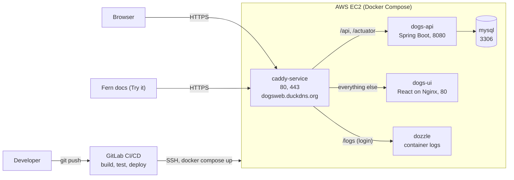

# Dogs Web API

A full-stack breeds and sub-breeds management application built with Spring Boot, React, MySQL, and Docker. Users can import and perform CRUD operations on the breeds and sub-breeds.


## Live Demo

- **Live app:** [Dogs Web API](https://dogsweb.duckdns.org)
- **Documentation site:** Guides and API reference, try out the endpoints using `Try it`: [Dogs Web API Docs](https://dogsweb.docs.buildwithfern.com)

> **Note:** List starts empty until you add breeds or import them. Refer to docs/dogs.json for sample file.

## Features

- **CRUD operations:** Create, Read, Update and Delete breeds and sub-breeds.
- **Import:** Supports importing breeds (example: `docs/dogs.json`)
- **Pagination:** Cursor based pagination.
- **Server side validation:** Failures or errors are displayed in popups.
- **Optimistic locking:** Preventing conflicting edits when two or more users edit same item at once.
- **Health check:** Exposes actuator endpoints to view the health status (`/actuator/health`) and the running git commit (`/actuator/info`).
- **Request id:** Every request gets an id, returned in the `X-Request-Id` header and in error responses, and printed in the logs for easy debugging.
- **Logs:** View the live app container logs at <https://dogsweb.duckdns.org/logs> (login required) using Dozzle. This is for production only, locally see the logs in the terminal. To debug an error, search its `requestId` in the `dogs-api` logs.
- **HTTPS:** Served over HTTPS with a free Let's Encrypt certificate using Caddy.

## Tech Stack

- **Backend:** Java, Spring Boot
- **Frontend:** React
- **Database:** MySQL, Flyway
- **DevOps:** Docker, Docker Compose, Caddy, GitLab CI/CD, AWS EC2, Dozzle
- **Docs:** Fern
- **Testing:** JUnit, Mockito, k6

## Architecture

A Spring Boot service with MySQL database and React with Vite for frontend. Caddy sits in front of both and sends `/api` and `/actuator` requests to the backend, `/logs` to Dozzle and everything else to the UI.



Only Caddy is open to the internet. The other containers talk to each other inside the Docker network.

| Service | Responsibility |
|---------|---------------|
| caddy-service | Reverse proxy and HTTPS |
| dozzle | View container logs |
| dogs-api | Breed and sub-breeds management |
| dogs-ui | User interface |
| mysql | Database |

### Service Ports

| Service | Port | Publicly Accessible |
|---------|-----|----------------------|
| caddy-service | 80, 443 | Yes |
| dogs-api | 8080 | No (through Caddy) |
| dogs-ui | 80 | No (through Caddy) |
| mysql | 3306 | No |
| dozzle | 8080 | No (through Caddy, login required) |


## How to Use

### UI Walkthrough
1. Open the live app, click `Import breeds` button and choose the json file and click `Import` to import the breeds.

   

2. Browse the breeds list using `Load More` button.

3. Add breeds using `Add breed` button, edit and delete the breeds using buttons in `Action` column.

   

4. Click on any breed name (example : `hound`) to view, add, edit and delete the sub-breeds.

   

5. Any failures or errors are displayed in the browser popups.

### APIs

- **Base URL:** `https://dogsweb.duckdns.org/api/v1`
- **Full interactive docs:** [Dogs Web API Docs](https://dogsweb.docs.buildwithfern.com)

| Method | Endpoint | Description |
|--------|----------|-------------|
| POST | /api/v1/breeds | Create a breed |
| GET | /api/v1/breeds?lastId={lastId} | List breeds (Cursor based pagination) |
| GET | /api/v1/breeds/{id} | Get a breed |
| PUT | /api/v1/breeds/{id} | Update a breed |
| DELETE | /api/v1/breeds/{id}/{version} | Delete a breed |
| POST | /api/v1/breeds/import | Import breeds (JSON file, max 500 KB) |
| POST | /api/v1/breeds/{breedId}/subbreeds | Create a sub-breed |
| GET | /api/v1/breeds/{breedId}/subbreeds?lastId={lastId} | List sub-breeds (Cursor based pagination) |
| GET | /api/v1/breeds/{breedId}/subbreeds/{id} | Get a sub-breed |
| PUT | /api/v1/breeds/{breedId}/subbreeds/{id} | Update a sub-breed |
| DELETE | /api/v1/breeds/{breedId}/subbreeds/{id}/{version} | Delete a sub-breed |
| GET | /actuator/health | Application health check |
| GET | /actuator/info | Running git commit |


**Create a breed**

*Request*
``` json
POST /api/v1/breeds

{
  "name": "Corgi",
  "subBreeds": [
    "american", "european"
  ]
}
```

*Response*
``` json
{
  "createdAt": "2026-11-19T22:51:00.833234Z",
  "id": 1787,
  "modifiedAt": "2026-11-19T22:51:00.833234Z",
  "name": "Corgi",
  "subBreeds": [
    "american",
    "european"
  ],
  "version": 0
}
```

**Update a breed (Optimistic Locking)**

*Request*
``` json
PUT /api/v1/breeds/1787

{
  "name": "Labrador",
  "version": 0
}
```

Send the `version` you last read. If someone else updated the breed before your request did, the request is rejected with `409 Conflict` and you need to reload the latest data before retrying.

**Error response**

All errors return the same format. Share the `requestId` when reporting an issue, it helps to find the request in the logs.

``` json
{
  "status": 409,
  "error": "Conflict",
  "message": "Breed was modified by another user, please refresh and try again",
  "timestamp": "2026-11-23T09:45:03.112Z",
  "requestId": "3f9a1c2e"
}
```


## Run Locally With Docker Compose

### Prerequisites

- Docker with Docker compose (Docker Desktop)
- Git
- Ports **80** and **443** free on your machine

### Steps

1. Clone the repository:

   ``` bash
   git clone https://github.com/Kalyan-Mandhula-Dev/Dogs-Web-API.git
   cd Dogs-Web-API
   ```

2. Create the backend environment file. Containers read their settings from this files, because these values are not stored in `docker-compose.yaml`:

   ``` bash
   cp .env.example .env
   ```

   Update the values in `.env` (profile, domain, database username, password and root password). Keep `DOMAIN=localhost` for local.


3. Create the UI environment file. Vite reads `VITE_*` values when the UI is built:

   ``` bash
   cp dogs-ui/.env.example dogs-ui/.env
   ```
   Set the API URL in `dogs-ui/.env`:

   ```
   VITE_DOGS_API_URL=/api
   ```

   The UI and API are served from the same address through Caddy, so a relative `/api` works for both local and live.

4. Build and start everthing:

   ``` bash
   docker compose up --build -d
   ```

   Multi-stage `Dockerfile` builds the jar not need to build jar explicitly.

5. Open the application at <https://localhost>:

   Caddy uses its own local certificate for `localhost`, so the browser may show a warning the first time. The breeds list starts empty. Add the breeds or import from `dogs.json`.

To stop everything, run `docker compose down`.


## Configuration

Backend settings go in `.env` at the project root. The UI setting goes in `dogs-ui/.env`.

| Variable | Description |
|----------|-------------|
| `SPRING_PROFILES_ACTIVE` | Spring profile, `dev` or `prod` |
| `DOMAIN` | Domain Caddy serves, `localhost` for local, `dogsweb.duckdns.org` for live |
| `DATABASE_USERNAME` | Database user the app connects as |
| `DATABASE_PASSWORD` | Password for that user |
| `DATABASE_ROOT_PASSWORD` | MySQL root password, used by the database container |
| `LOGS_USER` | Username to open `/logs` (production only) |
| `LOGS_PASSWORD_HASH` | Password hash to open `/logs` (production only), created with `caddy hash-password` |
| `VITE_DOGS_API_URL` | API address the browser calls (`dogs-ui/.env`), `/api` |


## Tests

### Unit Tests

The docker build skips the tests (`-DskipTests`) to keep the image build fast, so run them separately. They dont need Docker or running database.

``` bash
cd dogs-api
./mvnw test
```

Results are printed in the terminal.

### k6 Test (Optimistic Locking)

This test sends conflicting updates to the same breed to show that only one succeeds, which prevents data inconsistency.

**Prerequisites:** k6 installed and the app running locally. This test is only for local, to show the optimistic locking works. Don't run it against the live app, because it edits real data. The script targets `http://localhost/api/v1/breeds` (`PUT Request`) by default.


1. Create a breed or pick an existing one, and note its `id`, `name` and `version`.

2. Open `dogs-api/performance-tests/OptimisticLockTest.js` and replace the placeholders with those values:

   ```javascript
   const BODY = JSON.stringify({
     name: '<breed-name>',
     version: <breed-version>
   });

   const response = http.put(BASE_URL + '/<breed-id>', BODY, PARAMS);
   ```

3. Run the test:

   ```bash
   cd dogs-api/performance-tests
   k6 run OptimisticLockTest.js
   ```

Only one of the conflicting requests succeeds. The others fail with `409 Conflict`.

The successful request increments the breed's `version`, so update `version` in the script before running the test again.

## Project Structure

```text
Dogs-Web-API/
├── dogs-api/              # Spring Boot backend
│   ├── src/main/java/...  # controller, service, repository, entity, dto, exception, config
│   ├── src/main/resources # config and Flyway migrations
│   ├── src/test/          # JUnit and Mockito tests
│   └── performance-tests/ # k6 script
├── dogs-ui/               # React and Vite frontend
├── fern/                  # Fern docs (guides and API reference)
├── Caddyfile              # Reverse proxy and HTTPS
├── .gitlab-ci.yml         # CI/CD pipeline
├── docker-compose.yaml
└── .env.example
```

## Deployment

The app is deployed on a single AWS EC2 instance using Docker Compose, through a GitLab CI/CD pipeline. It is available at <https://dogsweb.duckdns.org> (free DuckDNS domain pointing to the EC2 Elastic IP).

Every push to `main` runs the pipeline:

1. **Build:** builds the backend jar and the frontend.
2. **Test:** runs the unit tests.
3. **Deploy:** copies the code to EC2 over SSH, creates the `.env` files from the GitLab CI/CD variables, runs `docker compose up --build -d` and removes old images.

The deployed git commit is passed to the app, check it at <https://dogsweb.duckdns.org/actuator/info>.

The EC2 security group allows SSH (22), HTTP (80) and HTTPS (443) only. Caddy gets and renews the HTTPS certificate automatically. The database volume is kept, so data survives redeploys.

## Design Decisions

- **Separate breeds and sub-breeds tables (one-to-many):** Avoids repeating breed data on every sub-breed row, keeps updates simple.
- **Cursor-based pagination (`lastId`):** The query asks directly the next page data using the index instead of scanning them and skipping like offset pagination, so it stays fast on large data. The trade-off is no jumping to arbitrary page numbers.
- **Optimistic locking (`version` field):** Handles conflicting updates of the same record. The second update gets `409 Conflict` instead of overwriting the first.
- **All-or-nothing import:** The data in file is validated and saved in a single transaction, avoiding partial data saving.

## Limitations and Future Work

- **Filtering and search:** The breeds list cannot be filtered or searched any field yet.
- **Sorting:** Results are returned in a fixed order, with no sorting.
- **Authentication:** There is no login, anyone with the link can view and change data. JWT-based auth would be next step.